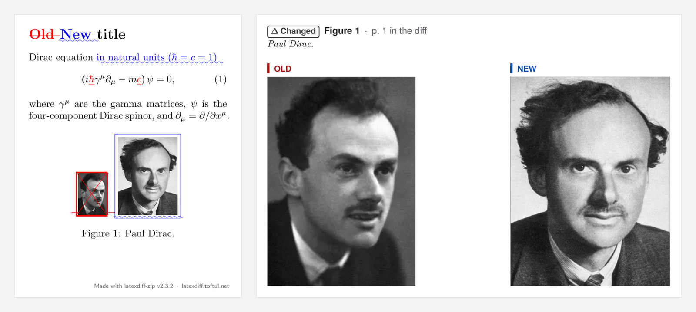

# latexdiff-zip

latexdiff-zip makes one track-changes PDF from two versions of a LaTeX project. It compares
the text ***and*** the figures. Each version can be an Overleaf `.zip` export, an arXiv
`.tar.gz` source, or an arXiv ID.

I host a copy that you can use now: </br>
**<https://latexdiff.toftul.net/>**

Drop your two archives (`.zip` or `.tar.gz`) on the page, or paste two arXiv IDs. The page
builds the diff PDF and shows it.



*Left: the text diff, with old text in red strikethrough and new text underlined in blue.
Right: the appendix compares each changed figure, OLD next to NEW.*

## What the PDF shows

- **The text diff** from `latexdiff`. Old text is red, with a strikethrough. New text is blue
  and underlined.
- **The bibliography diff** for BibTeX documents. An edit to a `.bib` entry shows like any
  other text change.
- **A "Figure changes" appendix** at the end of the PDF:
  - The first page lists each changed, added, and removed figure, with a link to each one.
  - Each comparison shows the figure number, its page in the diff, and its caption.
  - The words OLD and NEW label every panel, so color is not the only signal.
  - All text is real text that you can search and copy. Vector figures stay vector.
- **A small label** at the bottom right of each page, with the version of latexdiff-zip
  that made the PDF and links to this website and repository.

## Run it yourself

### Command line: needs $\LaTeX$ and `python3`

1. Download the script:

   ```sh
   curl -O https://raw.githubusercontent.com/toftul/latexdiff-zip/main/latexdiff-zip.py
   chmod +x latexdiff-zip.py
   ```

2. Run it on two archives, or on two arXiv IDs:

   ```sh
   ./latexdiff-zip.py old.zip new.zip
   ./latexdiff-zip.py 1706.03762v1 1706.03762v2   # from arXiv
   ```

The script writes `diff.pdf`. [USAGE.md](USAGE.md) lists all options and gives more
examples.

The `main` branch can have changes that are not in a release yet. For a released version,
use a release tag in the URL instead of `main`, for example `v2.3.0`.

### Command line in a container: needs only Podman

Clone the repository, then run:

```sh
./latexdiff-zip-podman.sh old.zip new.zip
```

The script builds the container image on the first run. Keep both archives in the current
directory, because the container sees only that directory.

### Web UI: needs Podman

Clone the repository, then run:

```sh
./latexdiff-zip-web.sh        # builds on the first run, then serves http://localhost:8080
```

## On Overleaf? Make the diff there

You can also run `latexdiff` inside Overleaf. [OVERLEAF.md](OVERLEAF.md) shows how.

## Versions

The project uses [semantic versioning](https://semver.org/). [CHANGELOG.md](CHANGELOG.md)
lists the changes in each version. `./latexdiff-zip.py -V` prints the version. Each run
also prints it on the first line of its log, and the web page shows it in the footer. The
diff PDF records it in its Creator field.

## Docs

- [**Usage and options**](USAGE.md): every option, how the tool works, and its limits.
- [**Figure comparison**](FIGURES.md): how the tool pairs and compares figures.
- [**Self-hosting**](DEPLOY.md): run your own public copy behind a Cloudflare Tunnel.
- [**Changelog**](CHANGELOG.md): what changed in each version.

## Similar projects

- [**git-latexdiff-web**](https://github.com/am009/git-latexdiff-web): a web page that
  compares two Overleaf `.zip` exports in the browser and returns a PDF. It does not compare
  figures.
- [**comparxiv**](https://github.com/temken/comparxiv): a command-line tool that compares two
  arXiv versions. It needs a local TeX installation. Figure comparison is on its to-do list.
- [**3142.nl/latex-diff**](https://3142.nl/latex-diff/): a web page that runs `latexdiff` on
  two uploaded files. It returns `diff.tex`, not a PDF.

This project is different in three ways. It shows both versions of each changed figure in an
appendix of the PDF. It reads Overleaf `.zip` exports, tar archives, and arXiv IDs through
one interface. It also compares the bibliography, not only the body text.

## Feedback

To report a bug or suggest an idea, [open an issue](https://github.com/toftul/latexdiff-zip/issues). 🐮

## License

MIT
